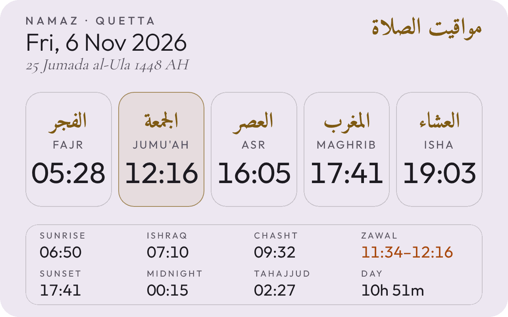

# Namaz Timings RSS

<picture>
  <source media="(prefers-color-scheme: dark)" srcset="assets/readme-card-dark.png">
  
</picture>

A daily RSS feed of prayer times for a city of your choice, from the free Aladhan API.

Each day gets one feed item titled like `2 Nov · 22 Jumada al-Ula`. It opens with a
**card image**: a transparent 1280×800 PNG (English and Arabic prayer names in glass
tiles, the extra times in a panel below, Zawal in amber, Jumu'ah tinted gold on Fridays)
with no background of its own, so it blends into the reader. Set `CARD_THEME` to `"dark"`
(light text, for dark-mode readers) or `"light"` (dark text, for light-mode readers). Readers that
show an item's first picture as a header (like Brief You) display it at the top.
The cards are drawn by `card.py` with headless Chromium, using the open-licence fonts
in `assets/fonts`. If drawing ever fails, the feed still goes out with text only.
Each item also carries a wide strip of just the five times as its thumbnail
(`media:thumbnail`), sized for list and Triage views, and a one-line summary as its
`<description>`; the full article is in `<content:encoded>`.

Below the card, the same information as text:

- the full Gregorian and Hijri dates (marked Jumu'ah on Fridays)
- Fajr, Dhuhr (Jumu'ah on Fridays), Asr, Maghrib, Isha
- extras: Sunrise, Ishraq (20 min after sunrise), Chasht (a quarter of the day after
  sunrise), Zawal (the Hanafi disliked time: midpoint of Fajr and Maghrib until Dhuhr),
  Sunset, Islamic midnight, Tahajjud and day length
- notes on special days: Islamic New Year, Ashura, 12 Rabi-ul-Awwal, Shab-e-Miraj,
  Shab-e-Barat, Ramadan, Shab-e-Qadr and the other odd nights, both Eids (with the Eid
  prayer window), Arafah, Takbeer-e-Tashreeq (9–13 Dhul Hijjah), the Days of Tashreeq when
  fasting isn't permitted, the white days (13–15), and a Surah Al-Kahf reminder on Fridays
  (shown on the card and in the text)
- Sehri / Iftar labels during Ramadan

All times are 24-hour. The feed keeps the last 7 days.

## Setup (about 5 minutes)

1. Create a new **public** GitHub repo, e.g. `namaz-feed`, and add these files.
2. Set your city in `generate_feed.py` (next section).
3. In the repo go to **Settings → Pages** and set **Source** to **GitHub Actions**.
4. Go to **Actions → Update namaz feed → Run workflow** to build it the first time.
5. Add this URL to your RSS reader:

   `https://<your-github-username>.github.io/namaz-feed/feed.xml`

After that it rebuilds itself every evening at 21:00 Pakistan time and publishes
**tomorrow's** timings, so you can see the next day's times the night before.

### Hijri dates

The Hijri date is calculated, then shifted by `HIJRI_ADJUST` to match Pakistan's moon
sighting (Ruet-e-Hilal is usually a day behind the calculation, hence `-1`). If you
notice the feed's Hijri date is a day off, change it to `0` or `-2`.

To make that easy to notice, the item for the 29th of each Hijri month carries a 🌙 note:
Ruet-e-Hilal meets that evening, so compare their announcement with the next day's
Hijri date in the feed.

### Saved timings (`data/`)

Prayer times are fixed by astronomy, so they're fetched a month at a time and saved
in `data/YYYY-MM.json`; the nightly run reads those files and normally makes **no API
call at all**. A month is fetched only when:

- its file is missing (from the 20th, next month is fetched ahead, so a failure has
  about 10 nights to be retried before it matters), or
- you changed `CITY`, `COUNTRY`, `METHOD`, `SCHOOL` or `TIMEZONE` (each file records
  what it was fetched with, so the next run refetches straight away).

API requests are retried a few times if the server is briefly down. The run commits
newly fetched files itself (that commit doesn't start another run) and deletes months
the feed no longer needs, so `data/` stays at two or three small files.
If your city is in another time zone, change the `cron` time in
`.github/workflows/feed.yml` (it's in UTC) and `NEXT_DAY_FROM` in `generate_feed.py`.

## Choosing the city and settings

Edit the settings at the top of `generate_feed.py`:

| Setting    | Example     | Notes                                                        |
|------------|-------------|--------------------------------------------------------------|
| `CITY`     | `"Lahore"`  | Any city Aladhan recognises                                  |
| `COUNTRY`  | `"Pakistan"`| Country name or code, e.g. `"UK"`                            |
| `TIMEZONE` | `""`        | Leave empty to detect it from the city                       |
| `METHOD`   | `"1"`       | Calculation method: 1 Karachi, 2 ISNA, 3 Muslim World League, 4 Umm al-Qura, 5 Egypt (full list on aladhan.com) |
| `SCHOOL`   | `"1"`       | Asr: 1 = Hanafi, 0 = Shafi'i                                  |
| `DAYS`     | `7`         | How many recent days the feed keeps                          |
| `NEXT_DAY_FROM` | `21`   | From this hour (local), the newest item is tomorrow          |
| `HIJRI_ADJUST` | `-1`    | Days to shift the calculated Hijri date to match local moon sighting; change to `0` or `-2` if it's ever a day off |
| `CARD_THEME` | `"dark"` | Card and thumbnail colours: `"dark"` for dark-mode readers, `"light"` for light-mode readers |

Committing the change rebuilds the feed straight away.
The feed's name follows the city: `Namaz Timings (<City>)`.

GitHub normally pauses scheduled jobs in repos with no activity for 60 days.
The workflow re-enables itself on every run (and the monthly data commits count as
activity too). If the feed ever stops updating anyway, open the Actions tab and
re-enable the workflow.
